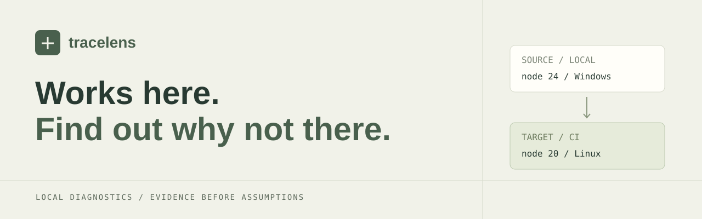

<p align="center"></p>

<p align="center">
  <a href="https://github.com/berkayozdmr21/tracelens/actions/workflows/verify.yml"></a>
  
  
  
  <a href="LICENSE"></a>
</p>

**A local diagnostic workbench for the gap between “works on my machine” and a failing CI run.** Capture two environments, compare observed differences, connect findings to log lines, and export a reviewable evidence bundle. No API key, model subscription or hosted account is required.

[Türkçe](README.tr.md) · [Architecture](docs/architecture.md) · [Rules and limits](docs/rules.md) · [Privacy](docs/privacy.md) · [Validation](docs/validation.md)

## The problem

A Windows developer imports `./services/UserService`, while Git tracks `services/userService.ts`. CI runs on Linux with Node 20 and an older .NET SDK; a required environment variable is also missing. A long build log contains symptoms of all three problems.

TraceLens makes those differences inspectable. Each finding has a stable rule identifier, observed facts, confidence, relevant paths, matching original log lines, and a suggested next check. A difference is a lead; it is **not proof of a root cause**.

## What you can do

| Capability | Behavior |
| --- | --- |
| Capture | Read project metadata, declared dependencies, runtime versions, lockfile hashes, environment-key presence and local import casing. |
| Compare | Evaluate deterministic rules for runtime constraints, missing keys, lockfile drift, Linux import casing, CRLF scripts and architecture changes. |
| Investigate | Filter findings, expand evidence, inspect environments side by side and follow log lines with original line numbers. |
| Keep track | Save local notes, complete/reopen checks, archive/restore investigations. Revision checks reject stale updates from another tab. |
| Export | Download a six-file ZIP after reviewing its metadata. Local review notes are excluded. |
| Continue in code | Generate a bounded ContextPilot handoff; optionally run an explicitly selected, trusted local helper. |

The Turkish workbench uses a restrained stone/olive palette, responsive panels, system fonts and native UI assets. It makes no external analytics, font or model requests.

## Start the workbench

Prerequisites: **Python 3.9+, Node.js 22.12+ (24 used in CI), .NET 10 SDK**, npm. Run commands from the repository root.

On Windows, double-click **BASLAT.cmd**, or run:

```powershell
powershell -NoProfile -File .\scripts\start.ps1
```

The script installs locked frontend dependencies, builds the API, checks ports, starts a hidden API process and keeps the frontend in the terminal. Keep that terminal open. Press Ctrl+C to stop. For subsequent starts after installation/build, use `-SkipInstall`. If local PowerShell policy blocks scripts, use the manual commands below rather than changing machine-wide policy.

Manual setup, terminal 1:

```sh
npm ci
dotnet build api -c Release
```

```powershell
# Windows PowerShell
$env:ASPNETCORE_URLS='http://127.0.0.1:9281'
$env:DataPath='.runtime/local'
dotnet api/bin/Release/net10.0/TraceLens.Api.dll
```

```sh
# Linux / macOS, instead of the PowerShell block
ASPNETCORE_URLS=http://127.0.0.1:9281 DataPath=.runtime/local \
  dotnet api/bin/Release/net10.0/TraceLens.Api.dll
```

Terminal 2:

```sh
npm run dev
```

Open **[http://127.0.0.1:9280](http://127.0.0.1:9280)**. Select **Örnek incelemeyi aç**, or create a new investigation and select two snapshot files. The example is synthetic and intentionally contains **4 critical findings, 5 warnings, 1 informational finding and 6 selected log lines**.

The API must start from the repository root: it uses the local `src/` engine and `examples/` files. Set `PythonPath` to an absolute Python executable if `python` is unavailable. Ports 9280/9281 must be free. This is a **single-user, loopback-only developer tool**, with no authentication and no internet deployment configuration.

## Use only the CLI

The engine has no third-party runtime dependencies; the workbench is optional.

```sh
python -m pip install .
tracelens --version
tracelens capture --root ./your-project --label Local --out local.snapshot.json
# Run this on the other environment, then bring its JSON back:
tracelens capture --root ./your-project --label CI --out ci.snapshot.json
tracelens compare local.snapshot.json ci.snapshot.json --log build.log --out report.json
tracelens bundle local.snapshot.json ci.snapshot.json --log build.log --out evidence.zip
tracelens context report.json --out handoff.md
```

Capture does not install dependencies, run project scripts, compile a project or execute fixes. Normal capture runs fixed `--version` commands for Node, Python, .NET and Git. `--no-probe` skips these runtime probes. Read-only Git file discovery may still run. A runtime executable located inside the inspected project is rejected.

Output files are never silently overwritten. Use a new name for each capture. A capture taken with `--no-probe` cannot establish runtime compatibility.

### ContextPilot bridge

[ContextPilot](https://github.com/berkayozdmr21/contextpilot) is optional. Without it, `context` produces a source-free handoff. To add bounded source excerpts locally:

```sh
tracelens context report.json --out local-context.md \
  --root ./your-project \
  --contextpilot /absolute/trusted/contextpilot/scripts/run.py
```

Only use a helper you trust. This explicit CLI operation executes that Python file and adds source excerpts to the output. The web API never accepts or executes a browser-supplied helper path. Review the resulting file before sharing it.

## Capture in CI

After checking out your own project, install this tool from a reviewed revision and run:

```yaml
- run: tracelens capture --root . --label 'Linux CI' --out ci.snapshot.json
- uses: actions/upload-artifact@v4
  with:
    name: environment-snapshot
    path: ci.snapshot.json
```

Capture after runtime setup and configuration injection if those facts are relevant. The snapshot records whether template-listed environment keys have a non-empty process value; it does not read `.env` values or retrieve remote CI secrets. The artifact still contains project metadata; apply your repository's access policy.

## Data boundaries

- Snapshots deliberately retain metadata, not source-file bodies or environment-variable values. Imported snapshots are rebuilt from an allowlist; unknown fields are dropped.
- Known credential patterns, private-key blocks and home paths are masked in logs and imported text. **Redaction is best effort**, not a guarantee of anonymity.
- Relative file paths, dependency names and log text can still reveal confidential information. Review the sharing preview and every bundle file.
- SQLite stores investigations under `.runtime/local`; notes remain local and are excluded from diagnostic exports. There is a 100-investigation cap per database, including archived cases.
- Capture has file/count/size limits. Unsupported or incomplete evidence is reported as unknown where modeled; a clean report does not prove a healthy build.

See [the privacy and threat model](docs/privacy.md) before using private company projects.

## Verify it

```sh
python -m pip install .
python -m unittest discover -s tests -v
npm ci
npm run build
dotnet build api
# Start the API in another terminal first:
npm run test:api
# Browser tests (CI runs these on Linux):
npx playwright install chromium
npm run test:ui
```

The verification workflow runs the Python engine on Windows/Linux with Python 3.9/3.12, then builds the web/API and exercises real persistence, validation, revision conflicts, downloads and responsive browser flows. Browser screenshots and traces are retained as workflow artifacts. [Test scope and interpretation](docs/validation.md).

## Repository map

```text
src/tracelens/     Python capture, sanitization, analysis and CLI
api/              ASP.NET Minimal API + EF Core SQLite persistence
web/              React/TypeScript workbench
examples/         Synthetic environment snapshots and failure log
tests/            Engine, HTTP integration and browser scenarios
scripts/          Example generation and Windows launcher
docs/             Architecture, rule coverage, privacy and validation
```

Current boundaries: no automatic remediation, cloud sync, authentication, full dependency resolution, container inspection, full semver parser or general-purpose root-cause inference. SDK roll-forward and package manager resolution need their own tools. See [rule coverage](docs/rules.md).

MIT licensed. Built and maintained by **Berkay Özdemir**.
