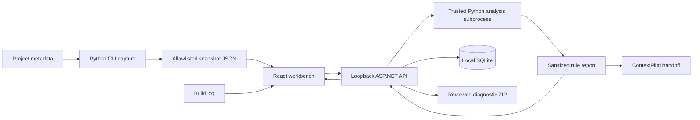

# Architecture

TraceLens separates capture from investigation. The browser cannot request an arbitrary filesystem scan or execute a project command.

## Engine

`collector.py` uses Git-aware file discovery or a bounded fallback walk. It reads selected metadata, checks local imports and hashes known lockfiles. Project hooks are never invoked. Fixed runtime probes run with a trusted working directory, no shell, timeouts and executable-location checks. Filesystem case sensitivity is measured using an existing file; no project file is written to test it.

`security.py` rebuilds imported snapshots from a schema allowlist, validates relative paths and masks known sensitive patterns. `analysis.py` returns deterministic findings and selected log evidence. Stable finding IDs allow review state to survive repeated reads. The CLI and API share this analysis engine.

## API and persistence

The API accepts JSON, calls its own Python module through standard input and persists the sanitized report. The subprocess has a 20-second timeout and a fixed module/working directory. Request size is capped at 4 MB. It does not run browser-supplied commands.

SQLite stores case ID, title, timestamps, report JSON, notes, resolutions, archive flag and revision. Mutations require the current revision, and EF Core uses a concurrency token to reject racing writes. Archive is reversible. The initial schema uses `EnsureCreated`; there is no upgrade/migration pipeline in v0.1. Back up a closed database before future upgrades. The 100-case cap is a local capacity guard, not a multi-user quota guarantee.

The browser's Vite proxy forwards `/api` to the loopback API. Host and write-origin checks reduce local browser exposure. There is no authentication layer: keep both servers bound to loopback. No remote storage, telemetry or model provider is involved.

## API contract

| Method | Path | Purpose |
| --- | --- | --- |
| GET | `/health` | Service readiness |
| GET | `/api/status` | Local version and count |
| GET | `/api/example` | Synthetic input fixture |
| GET | `/api/cases?archived=false` | Case cards |
| GET | `/api/cases/{id}` | Full report and review state |
| POST | `/api/cases` | `{title,left,right,log}` analysis |
| POST | `/api/cases/demo` | Analyze the synthetic fixture |
| PATCH | `/api/cases/{id}` | `{title,notes,archived,revision}` |
| PUT | `/api/cases/{id}/findings/{findingId}` | `{resolved,revision}` |
| GET | `/api/cases/{id}/export` | Six-file ZIP, no local notes |
| GET | `/api/cases/{id}/handoff` | Source-free diagnostic Markdown |

Invalid inputs return 400; unknown records 404; stale revisions 409; local-origin/host failures 403. No remote capture endpoint exists.

## ContextPilot

The default handoff is bounded diagnostic Markdown. Only the explicit CLI `--contextpilot` option runs a trusted helper, with a 30-second timeout and a 6,000-character source-context request. That output is a separate local file and is never silently added to the web ZIP.
